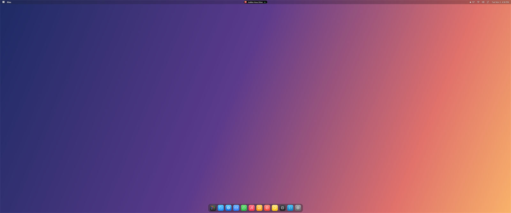
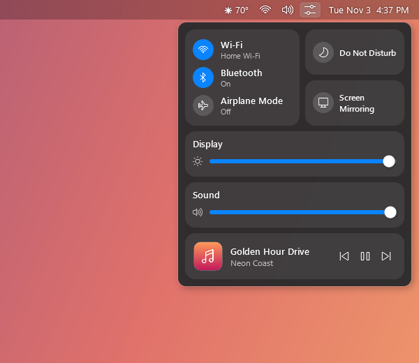
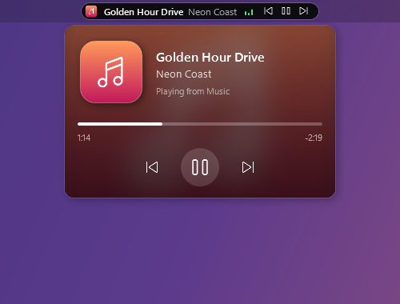
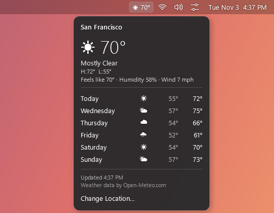
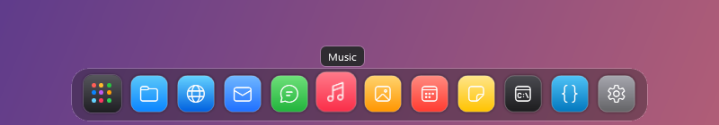
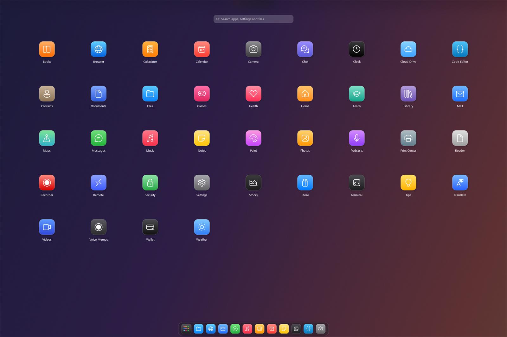
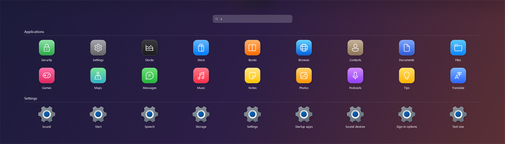

# MacBar

A macOS-style **menu bar** and **dock** for Windows 10/11. MacBar hides the Windows taskbar
while it runs and puts it back when you quit.

On Ubuntu? See [MacBar for Ubuntu](ubuntu/) (a GNOME Shell extension). Download **MacBar-Ubuntu.deb** from the
[latest release](https://github.com/ernest-it/MacBar/releases/latest) and run `sudo apt install ./MacBar-Ubuntu.deb`.



| Control Center | Now Playing | Weather |
|:---:|:---:|:---:|
|  |  |  |

**Dock**



**App page** (Windows key or the Apps button), with local search across apps and Settings




<sub>Screenshots were taken in demo mode (`MacBar.exe --demo`), which shows placeholder apps and content.</sub>

## Features
**Dock (bottom)**
- App icons only, centered; the dock grows and shrinks with the number of apps
- Pinned apps (imported from your Windows taskbar pins on first run), running apps after a divider
- Running-app dots, hover zoom, launch bounce, drag to reorder pinned apps
- **Apps** button (first in the dock) or the **Windows key** opens a Launchpad-style app page (the dock comes up with it): every installed app in a
  paged grid over a blurred backdrop, with instant search across apps, Settings pages and your files (local only: no Bing, no web results; Enter opens the top result), mouse-wheel /
  arrow-key paging, and right-click → Keep in Dock
- Auto-hides like macOS (slides back up when the cursor hits the bottom edge), or Ubuntu-style only when a window overlaps it
- Click: launch / focus / minimize / cycle windows. Right-click: window list, Keep in Dock,
  Remove from Dock, New Window, Show in File Explorer, Quit

**Workspaces** (system menu → Workspaces)
- Save where every window goes across your monitors, then put it all back in one click
- Reuses windows that are already open instead of starting second copies; only opens what's missing
  (or choose "Arrange Open Windows Only" to open nothing)
- Knows Chrome profiles: each Chrome window is matched to its own profile and missing ones open in that profile
- Aligns windows by their visible edges (no gaps from invisible borders) and re-checks for a few seconds
  so apps that restore their own position still end up in place
- Optional: run a workspace at sign-in, opening missing apps or only arranging windows as they appear
- Imports PowerToys Workspaces

**Menu bar (top)**
- Left: system menu (About, Settings, Task Manager, Sleep, Restart, Shut Down, Lock, Log Out)
  and the active app's name in bold
- Right, in order: tray icons → weather → Wi‑Fi → sound → battery (laptops only) → date & time (one button)
- Click an icon again to close its panel
- Windows' own sound, Wi‑Fi, battery, microphone and Bluetooth tray icons are left out (the menu bar and
  Control Center already cover them); hide any other tray icon under Settings → Menu bar
- **Wi‑Fi** panel: on/off switch, current network, known and other networks, connect/disconnect
- **Sound** panel: volume slider, mute, output device switcher, microphone switcher with a mic on/off switch; scroll over the icon to change volume
- **Control Center** (sliders icon next to the clock): Wi‑Fi, Bluetooth and Airplane Mode toggles,
  Do Not Disturb and Screen Mirroring tiles, display brightness (laptops and DDC/CI monitors),
  volume, and Now Playing
- **Now Playing island** in the middle of the menu bar: album art, title and live equalizer while
  music plays; hover for controls, click for a big player with blurred album-art background and a
  seekable progress bar (works with Spotify, browsers and any app using Windows media controls)
- **Calendar** panel: today's date, month calendar, shortcuts to notifications and Do Not Disturb
- **Lighting** (palette icon): your [OpenRGB](https://openrgb.org) profiles, one click to switch. Shown
  only while OpenRGB runs with its SDK server on (OpenRGB → SDK Server → Start Server)
- **Weather**: current conditions + 6-day forecast from [Open-Meteo](https://open-meteo.com) (no API key,
  no Windows location access; pick your city in Settings; °F or °C; refreshes every 30 min; works offline
  with the last known data)

**Both bars**
- Light transparency (20 %) with light blur by default; adjustable opacity 0–100 % and blur
  None / Light / Strong (fully transparent is possible)
- Subtle shadow behind icons and text so they're readable on light or dark wallpapers
- Automatic light/dark theme (or force one)
- Hide automatically when an app goes full screen (videos, games, F11). While hidden, hold the mouse at the
  top edge to bring the menu bar down (it hides again when you leave it), and the Windows key brings up the
  dock with the app page
- Windows use the full screen height; the menu bar reserves its strip by default so desktop icons and
  title bars aren't covered (both are configurable)

## Install
Download `MacBar-Setup.exe` and run it. It installs for the current user (no admin rights) to
`%LOCALAPPDATA%\Programs\MacBar`, adds Start menu shortcuts and an Apps & Features uninstall entry,
and can start MacBar when you sign in.

Silent install: `MacBar-Setup.exe /quiet` · Silent uninstall: `"Uninstall MacBar.exe" /uninstall /quiet`

### If the Windows taskbar doesn't come back
Run **Start → MacBar → Restore Windows Taskbar** (or `MacBar.exe --restore`).
This is only needed if MacBar was force-killed; normal quits restore the taskbar automatically.

## Build
No SDK needed. Windows ships the .NET Framework 4.8 C# compiler, so just run:

```
build.cmd
```

Outputs `bin\MacBar.exe` and `bin\MacBar-Setup.exe`. To regenerate the icon:
`powershell -ExecutionPolicy Bypass -File tools\make-icon.ps1`.

Set the environment variable `MACBAR_DEBUG=1` to write a trace to `%APPDATA%\MacBar\debug.log`.

## Known limitations
- Menu bar and dock show on the primary monitor only.
- Windows doesn't let regular desktop apps read your notifications, so the calendar panel links to
  Windows' Notification Center instead of listing notifications.
- Joining a *new* Wi‑Fi network (one that needs a password) hands off to the Windows network panel.
- Turning Wi‑Fi off may be refused by Windows on some PCs; MacBar then opens Wi‑Fi settings.
- Tray icons from apps that were already running and ignore the standard "taskbar created" signal
  appear after those apps restart.

See [NOTES.md](NOTES.md) for how it works and the development log.

Weather data by [Open-Meteo.com](https://open-meteo.com) (CC BY 4.0).
