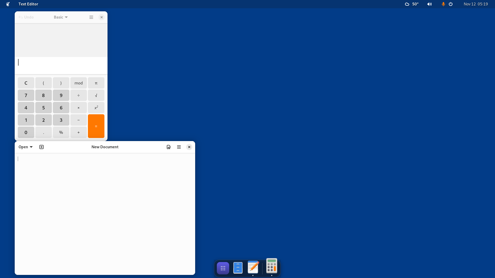
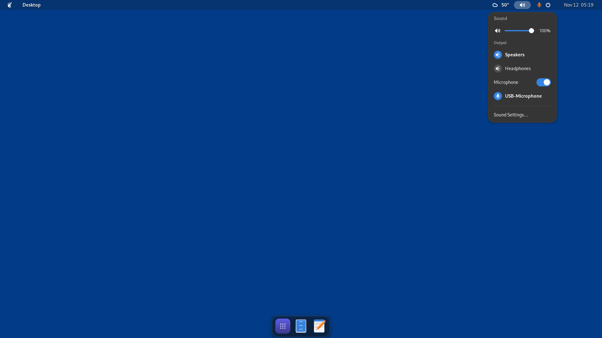
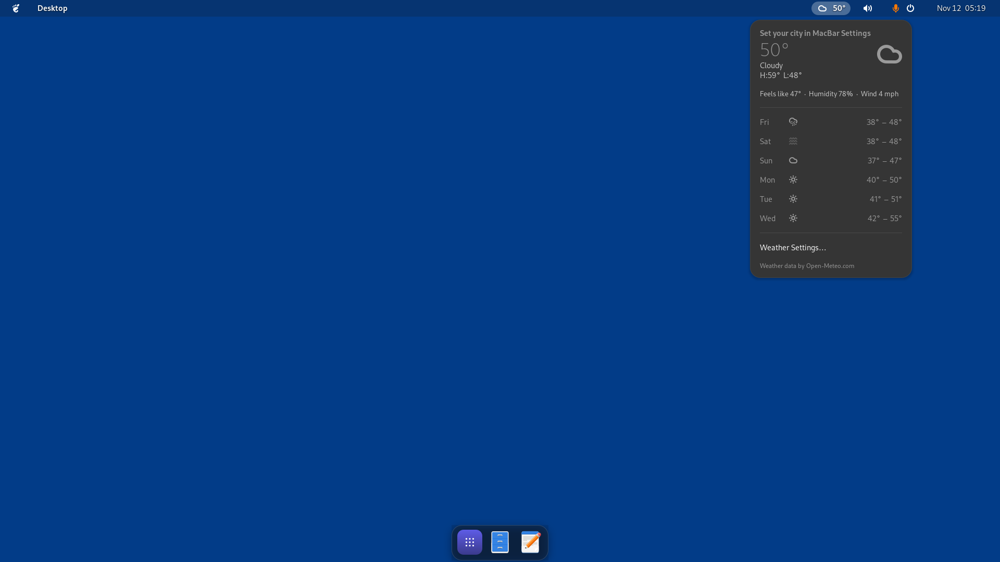
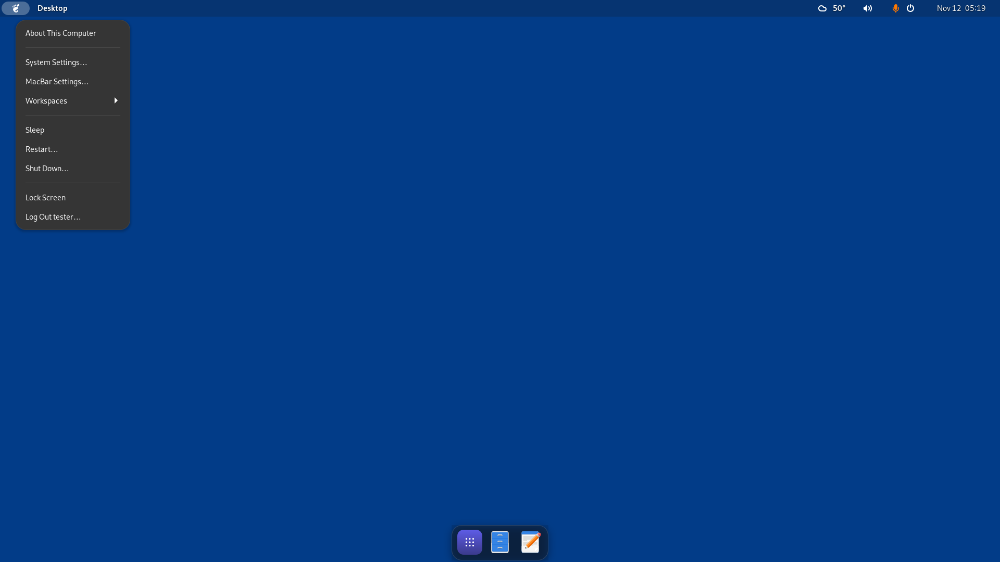

# MacBar for Ubuntu

The Ubuntu version of [MacBar](https://github.com/ernest-it/MacBar): a macOS-style **menu bar** and
**dock**. It's a GNOME Shell extension for the standard Ubuntu desktop, and works on Wayland and X11.
It needs Ubuntu 24.04 or newer (GNOME 45–49).



| Sound | Weather | System menu |
|:---:|:---:|:---:|
|  |  |  |

## Install

```
curl -fsSL https://github.com/ernest-it/MacBar/releases/latest/download/install.sh | bash
```

Then log out and back in. The installer works for your user only (no sudo). It turns off Ubuntu Dock,
which would sit under MacBar's dock; `uninstall.sh` turns it back on.

You can also download `install.sh` and `macbar@ernest-it.github.io.shell-extension.zip` from the
[latest release](https://github.com/ernest-it/MacBar/releases/latest), put them in one
folder and run `bash install.sh`.

To remove it, run
`curl -fsSL https://github.com/ernest-it/MacBar/releases/latest/download/uninstall.sh | bash`.

Settings: click the logo at the top left, then **MacBar Settings…**.

## Features

**Menu bar (top)**
- Left: the system menu, then the active app's name in bold.
  - The system menu has About This Computer, System Settings, MacBar Settings, App Center,
    Workspaces, Force Quit, Sleep, Restart, Shut Down, Lock Screen and Log Out.
  - Click the app name for New Window, Show All Windows and Quit.
- **Now Playing island** in the middle: album art, title and a live equalizer while music plays.
  - Click it for a player with large art, a seekable progress bar and previous / play-pause / next.
  - Works with Spotify, browsers and any player that supports MPRIS.
- Right, in order: OpenRGB lighting, weather, sound, then GNOME's own quick settings and the clock.
  - The quick settings act as the Control Center: Wi‑Fi, Bluetooth, power, brightness, Night Light
    and Do Not Disturb.
- **Sound**:
  - volume slider and mute
  - output device list and microphone list (click to switch)
  - a microphone on/off switch
  - scroll over the icon to change the volume
- **Weather** from [Open-Meteo](https://open-meteo.com): current conditions plus a 6-day forecast.
  - No API key and no location access: search for your city in Settings.
  - °F or °C. Refreshes every 30 minutes and shows the last data when you're offline.
- **Lighting**: your [OpenRGB](https://openrgb.org) profiles, one click to switch.
  - Shown only while OpenRGB runs with its SDK server on (OpenRGB → SDK Server → Start Server).
- Translucent (adjustable opacity), with a shadow behind text and icons so they stay readable on
  any wallpaper.

**Dock (bottom)**
- Apps button first (opens the app grid), then pinned apps, a divider and running apps.
  Running apps get a dot.
- Hover magnification, a bounce when an app launches, and drag to reorder.
  - Drag apps in from the app grid to pin them.
- Click to launch, focus, minimize or cycle through an app's windows. Middle-click opens a new window.
- Right-click for:
  - the app's window list
  - New Window and the app's own actions (e.g. New Incognito Window)
  - Keep in Dock / Remove from Dock
  - Quit
- Hiding options:
  - never (maximized windows stop above the dock)
  - always (macOS-style; it slides up when the mouse reaches the bottom edge)
  - only when a window overlaps it (Ubuntu-style)
- Translucent with blur.

**Full screen (games, videos)**
- Both bars hide while an app is full screen.
- Hold the mouse at the top edge for a moment and the menu bar slides down. It hides again when you
  move away. It doesn't trigger while a game has the mouse locked.
- The Super key brings up the app grid with the dock and menu bar over the game.

**Workspaces** (system menu → Workspaces)
- Save where every window goes across your monitors, then put it all back in one click.
- Reuses windows that are already open instead of starting second copies. Only what's missing gets
  opened, or choose **Arrange Open Windows Only** to open nothing.
- For apps that are running but have no window, it asks the app for a new window instead of starting
  the program again.
- Restores maximized and minimized windows and virtual desktops (GNOME workspaces). It keeps
  re-checking for a few seconds, so apps that move their own window after starting still end up in place.
- Chrome profiles: pick a profile for each Chrome entry and a missing one opens in that profile.
- Optional: run a workspace when you sign in, either opening missing apps or only arranging windows
  as they appear.
- To create one: arrange your windows, then use **Save Open Windows as New Workspace**.
  Rename workspaces, pick Chrome profiles and set the sign-in option in MacBar Settings → Workspaces.

**Behavior**
- The Super key opens the app grid, like Launchpad (can be turned off).
- Login starts on the desktop instead of the overview.

## Known limitations
- The menu bar is tinted, not blurred. A background blur behind GNOME's top panel paints black, so
  only the dock uses blur.
- Chrome on Linux doesn't tell other programs which profile a window belongs to.
  - Workspaces opens each missing profile correctly and places the window that opens.
  - When several Chrome profiles are already open, they're matched by position, or by an optional
    "title contains" hint you can set per entry.
- Apps without a .desktop file are restarted with the command line they were running with.
- Menu bar and dock show on the primary monitor.

## How it's tested
`test/` (in this `ubuntu` folder) builds headless GNOME Shell images for Ubuntu 24.04, 25.04 and 25.10 in Docker and runs
`selftest.js` inside the real shell. The self-test:
- opens the menus and checks the dock
- launches apps and runs Workspaces: arrange only, maximized, reopen a missing app, no duplicates
- makes a window full screen and checks the top-edge peek
- opens the app grid and the settings window, taking screenshots along the way

```
cd ubuntu
docker build -t macbar-gnome test
docker run --rm --user root -v "$PWD:/src" -v "$PWD/test/out:/out" macbar-gnome bash /src/test/docker.sh
```

Weather data by [Open-Meteo.com](https://open-meteo.com) (CC BY 4.0).
